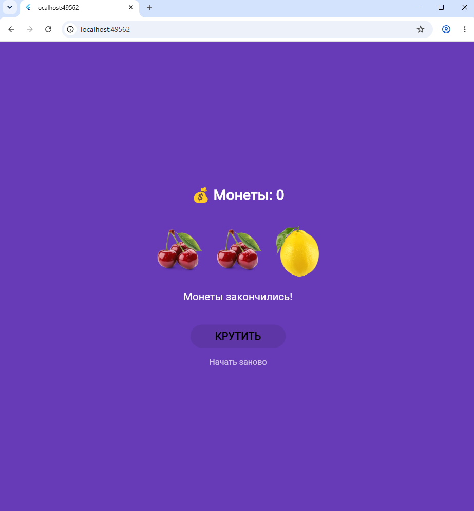

# Лабораторная работа №9. Flutter: StatefulWidget и управление состоянием
**ФИ: Домрачевой Полины**

**Группа: ИСП-241**

**Дата сдачи: 04.11.26**

## Что изучила
- Как работает `StatefulWidget` изнутри: зачем нужен отдельный класс `State` и как через `setState()` обновлять экран (монеты, картинки, сообщения).
- Блокировка UI во время асинхронных операций: Изучено, как временно отключать интерактивные элементы (кнопки), передавая null в их обработчик onPressed на время выполнения анимации или загрузки.
- Создание плавных анимаций интерфейса с помощью `AnimatedOpacity` и `AnimatedSwitcher`.
- Игровая асинхронность: с помощью `Future.delayed` и `Future.wait` сделали так, чтобы три барабана крутились вместе, но останавливались по очереди с разной скоростью.

## Скриншот финального приложения

## Инструкция по запуску

1. git clone https://github.com/chipollina/Flutter_Lab9.git
2. cd Flutter_Lab9
3. flutter pub get
4. flutter run -d chrome